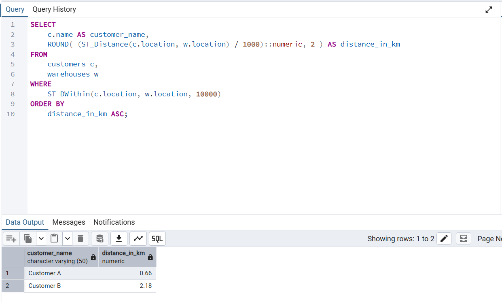

# Project 2: Radius Search (ST_DWithin)

**Objective:** 
Find all customer locations within a 10-kilometer radius of the central warehouse using spatial filtering.

**Tools Used:** 
PostgreSQL, PostGIS, pgAdmin 4

**The Query:** 
This query uses the PostGIS `ST_DWithin` function. Unlike calculating the distance for everyone, `ST_DWithin` acts as a boolean filter (True/False) to instantly return only the points that fall within the specified 10,000-meter radius. 

**The Result:**

*Result: Customer C (17.52km) was successfully filtered out by the 10km radius constraint. Only Customer A (0.66km) and Customer B (2.18km) were returned.*
