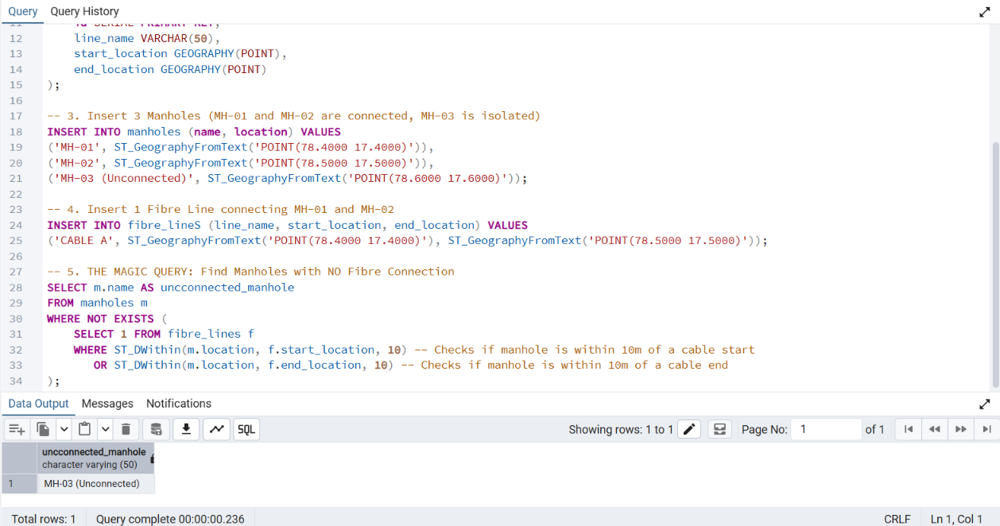

# Project 3: Telecom Network Validation (QA/QC)

**Objective:** 
Identify isolated manholes that do not have a fibre cable connection, ensuring network completeness for telecom and utility infrastructure projects.

**Tools Used:** 
PostgreSQL, PostGIS, pgAdmin 4

**The Query:** 
This query uses a `NOT EXISTS` subquery combined with the PostGIS `ST_DWithin` function. It checks every manhole against the start and end locations of all fibre lines. If a manhole is not within 10 meters of any cable endpoint, it is flagged as unconnected.

**The Result:**

*Result: The query successfully identified `MH-03 (Unconnected)` as the only isolated manhole in the dataset.*
