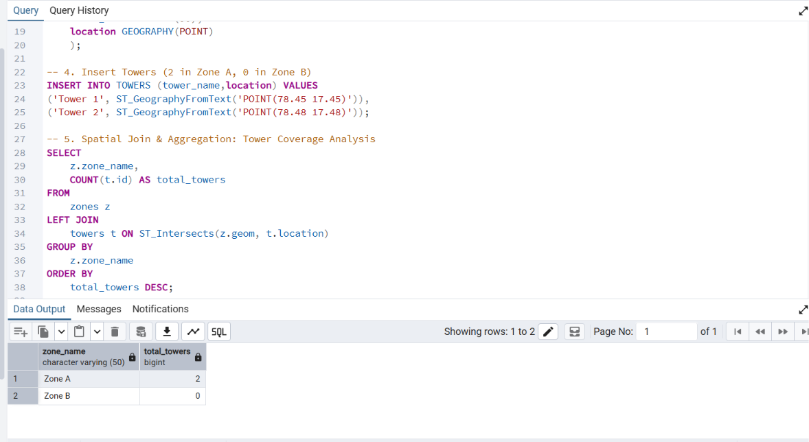

# Project 4: Telecom Tower Coverage Analysis

**Objective:** 
Perform a spatial join and aggregation to determine how many telecom towers exist within specific city zones, and identify zones with zero coverage (coverage gaps).

**Tools Used:** 
PostgreSQL, PostGIS, pgAdmin 4

**The Query:** 
This analysis uses a `LEFT JOIN` to ensure every zone is listed in the final output, even if it contains no towers. It uses the PostGIS `ST_Intersects` function to check if a tower's Point falls inside a zone's Polygon. Finally, it uses `COUNT` and `GROUP BY` to aggregate the total number of towers per zone, and `ORDER BY` to rank them.

**The Result:**

*Result: The query successfully identified that Zone A contains 2 towers, while Zone B contains 0 towers. This type of query is critical for telecom network planners to identify coverage gaps before deploying new infrastructure.*
