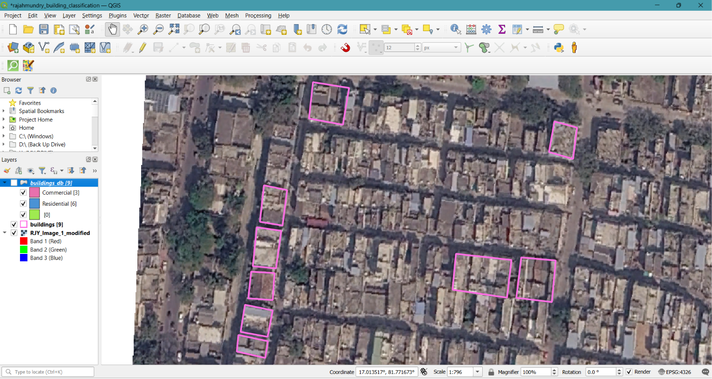
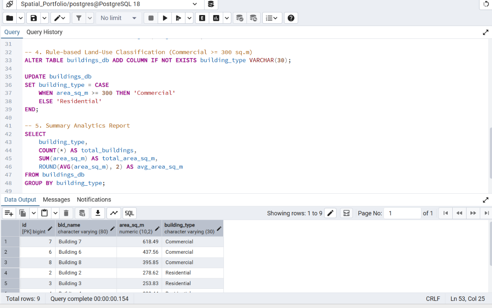
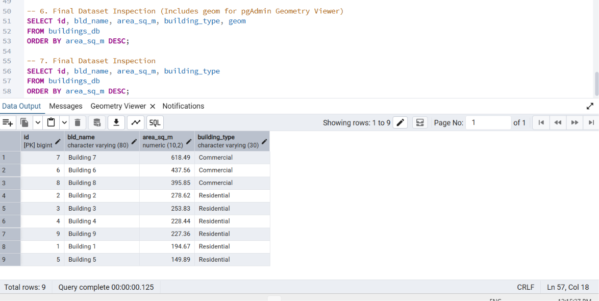
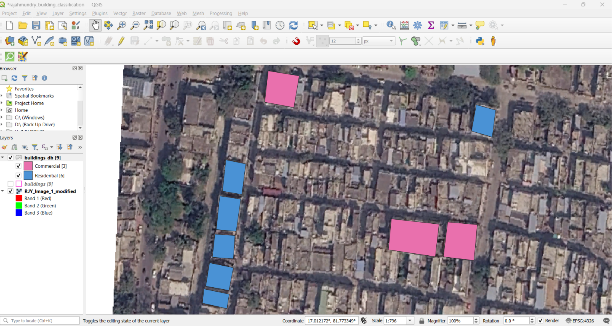

## Project 5: End-to-End Spatial ETL & Urban Building Classification

**Objective:** Georeference raw satellite imagery of Rajahmundry, digitize urban building footprints in QGIS, migrate the spatial dataset into PostGIS, validate geometry topology, and automate rule-based Commercial vs. Residential classification using geodesic surface area.

**Tools Used:** QGIS, PostgreSQL 18, PostGIS, pgAdmin 4

**The Query:** This pipeline first establishes spatial alignment in `EPSG:4326` and migrates the vector layer into PostGIS (`buildings_db`) with a GIST spatial index. In SQL, it uses `ST_Area(geom::geography)` to calculate true geodesic surface area in square meters, runs `ST_IsValid` and `ST_Intersects` to confirm zero topological overlaps or broken geometries, and uses a `CASE` statement to classify buildings (`>= 300 m²` as Commercial, `< 300 m²` as Residential) before visualizing the result back in QGIS.

**The Result:**

### 1. Georeferencing & Vector Digitization (QGIS)

### 2. Spatial SQL Engineering & Classification (pgAdmin 4)

### 3. Round-Trip Cartographic Visualization (QGIS)

**Result:** The spatial ETL pipeline successfully validated all 9 digitized building footprints with zero topological errors and classified them into **3 Commercial buildings** (395.85 m² – 618.49 m²) and **6 Residential buildings** (149.89 m² – 278.62 m²). This end-to-end workflow demonstrates how manual desktop GIS digitization transitions into automated, scalable spatial database engineering.
