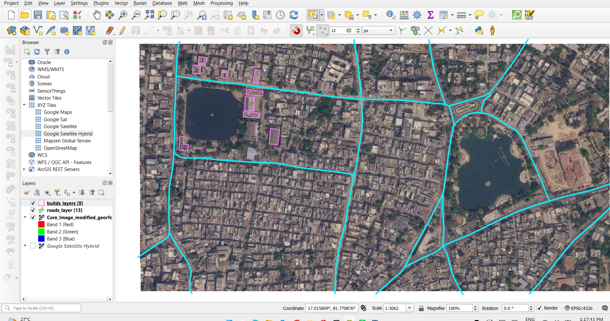
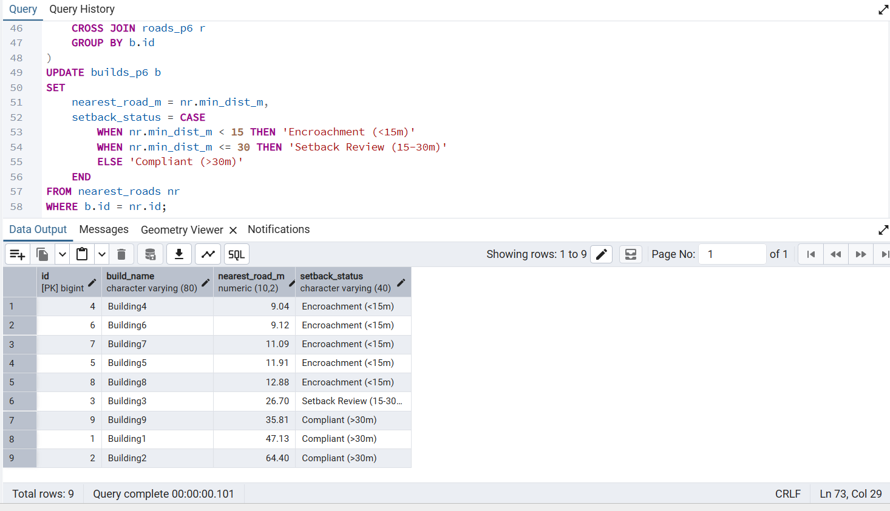
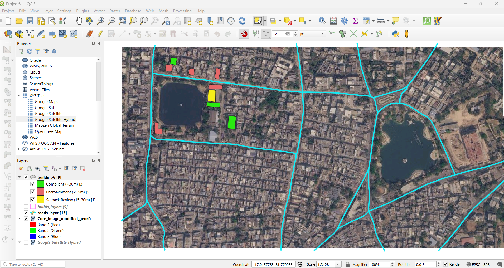

## Project 6: Urban Road-Network Buffer & Building Setback Compliance Analysis

**Objective:** Georeference raw satellite imagery of Rajahmundry using live basemap control points (`EPSG:4326`), digitize a multi-segment urban street network and building footprints in QGIS, migrate both vector layers into PostGIS, validate geometry topology, and automate road-widening setback compliance classification using nearest-neighbor geodesic distance.

**Tools Used:** QGIS, PostgreSQL 18, PostGIS, pgAdmin 4

**The Query:** This pipeline aligns raw imagery directly against live basemap intersections (`From Map Canvas`) in `EPSG:4326` and migrates 13 road centerlines (`roads_p6`) and 9 building polygons (`builds_p6`) into PostGIS with GIST spatial indexes. In SQL, it calculates geodesic road segment lengths (`ST_Length(geom::geography)`), verifies zero topological errors (`ST_IsValid`), computes each building's shortest geodesic distance across all 13 road segments (`MIN(ST_Distance(b.geom::geography, r.geom::geography))`), and applies a `CASE` classification rule (`< 15m` Encroachment, `15–30m` Setback Review, `> 30m` Compliant) before rendering the categorized map back in QGIS.

**The Result:**

### 1. Live-Basemap Georeferencing & Network Digitization (QGIS)

### 2. Spatial SQL Nearest-Road & Setback Classification (pgAdmin 4)

### 3. Round-Trip Traffic-Light Compliance Map (QGIS)

**Result:** The spatial pipeline validated all 22 vector features (13 road segments and 9 building footprints) with zero topological errors and classified the buildings into **5 Encroachment (<15m)** structures (`9.04 m – 12.88 m`), **1 Setback Review (15–30m)** structure (`26.70 m`), and **3 Compliant (>30m)** structures (`35.81 m – 64.40 m`). This demonstrates multi-layer network proximity analysis and municipal setback auditing in a repeatable QGIS + PostGIS workflow.
