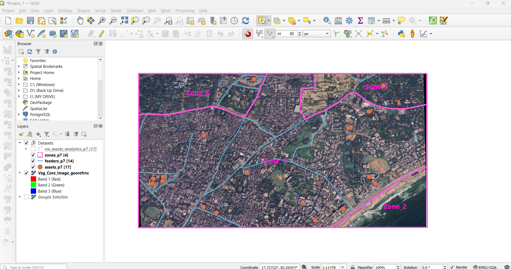
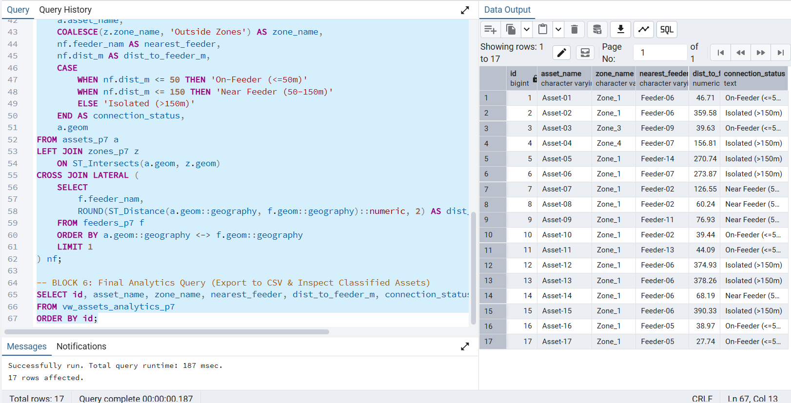
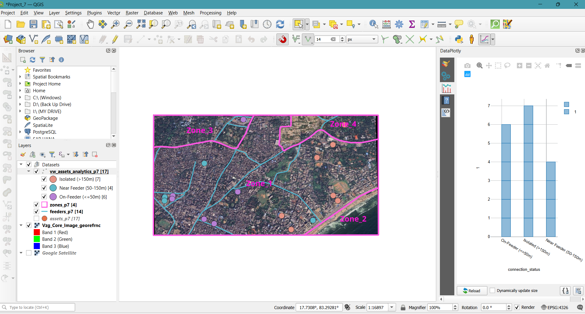

## Project 7: Urban Utility Infrastructure & Zone Analytics Dashboard (Visakhapatnam)

**Objective:** Georeference coastal urban satellite imagery of Visakhapatnam (`EPSG:4326`), digitize a multi-geometry utility network (4 zone polygons, 14 feeder lines, and 17 utility asset points) using topological boundary tracing, execute spatial joins and KNN nearest-feeder proximity analysis in PostGIS, and build an interactive QGIS + DataPlotly visual analytics dashboard.

**Tools Used:** QGIS, DataPlotly Plugin, PostgreSQL 18, PostGIS, pgAdmin 4

**The Query:** This end-to-end pipeline aligns Visakhapatnam coastal imagery (`EPSG:4326`), enforces gap-free shared boundaries via QGIS vertex/segment tracing, and migrates all three geometry layers into PostGIS with GIST spatial indexes. In SQL, it validates topology across all 35 features (`ST_IsValid`), standardizes asset/feeder identifiers (`LPAD`), aggregates asset counts and geodesic feeder lengths per zone (`ST_Intersects` + `ST_Intersection`), and creates a dynamic PostGIS view (`vw_assets_analytics_p7`) using KNN nearest-neighbor distance (`<->`) and `CASE` classification (`On-Feeder <=50m`, `Near Feeder 50–150m`, `Isolated >150m`) linked directly to QGIS DataPlotly charts.

**The Result:**

### 1. Multi-Layer Georeferenced Utility Network & Zone Map (QGIS)

### 2. Spatial SQL Joins, KNN Proximity & Dynamic Analytics View (pgAdmin 4)

### 3. Interactive Split-Screen Map & DataPlotly Visual Dashboard (QGIS)

**Result:** All 35 vector features passed topological validation with zero invalid geometries. The spatial analytics view classified the 17 utility assets across Visakhapatnam into **6 On-Feeder (`<=50m`)**, **4 Near Feeder (`50–150m`)**, and **7 Isolated (`>150m`)** structures (ranging from `27.74 m` to `390.33 m` from the nearest feeder) and linked live PostGIS attributes directly to interactive DataPlotly bar charts inside QGIS.
