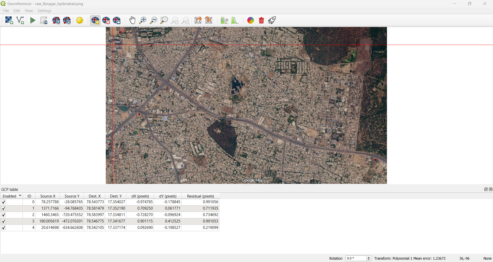
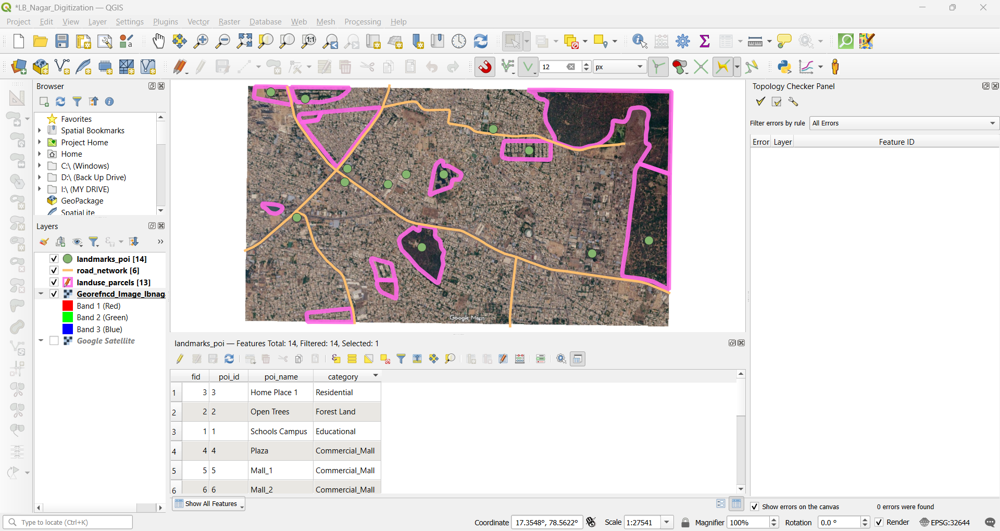
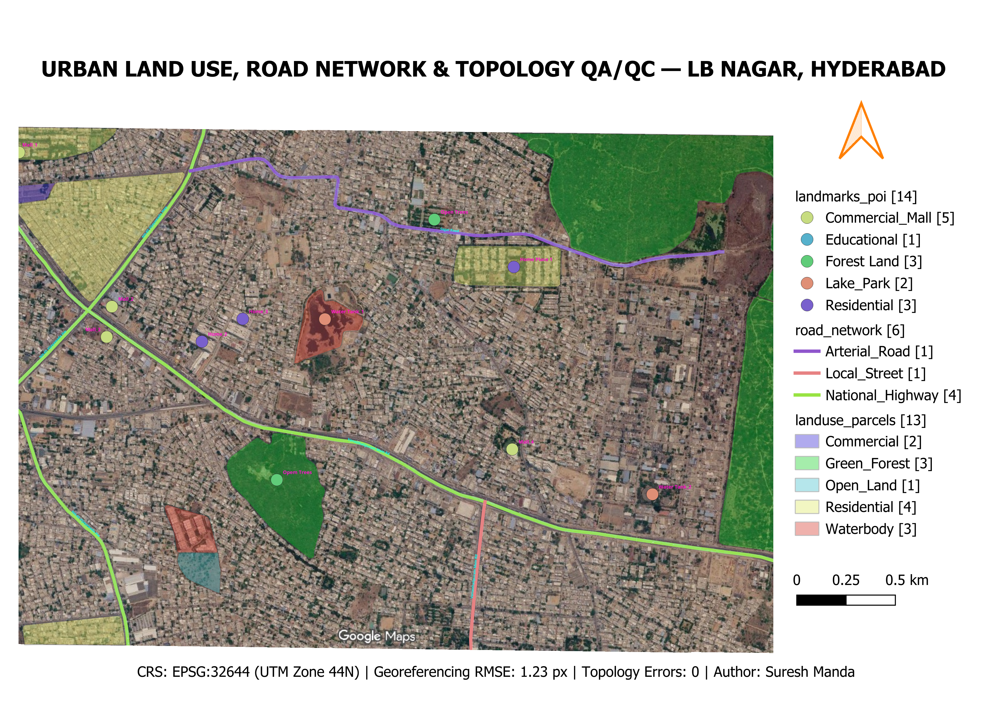

## Project 8: End-to-End Urban Georeferencing, Advanced Vector Digitization & Topology QA/QC (Pure QGIS)

**Objective:** Execute a complete manual desktop GIS production pipeline in QGIS—from raw unreferenced imagery georeferencing (`EPSG:32644`) and enterprise GeoPackage schema design to precision snapping/tracing digitization, zero-error Topology Checker validation, and 300-DPI cartographic print layout design for **LB Nagar, Hyderabad**.

**Tools Used:** QGIS (Georeferencer, GeoPackage `.gpkg` Attribute Forms & Value Maps, Snapping/Tracing/Split Tools, Topology Checker, Print Layout Composer)

**Workflow & Methodology:**
1. **Sub-Pixel Georeferencing (`EPSG:32644`):** Georeferenced raw satellite imagery of LB Nagar, Hyderabad into `WGS 84 / UTM Zone 44N` using 6 well-distributed Ground Control Points (GCPs) with `Polynomial 1` transformation, achieving a mean residual error of **`1.23 pixels`**.
2. **GeoPackage Schema & Domain Governance:** Designed a multi-layer GeoPackage (`LB_Nagar_Urban_GIS.gpkg`) containing `landuse_parcels` (`13` polygons), `road_network` (`6` highway/arterial segments), and `landmarks_poi` (`14` POIs), configured with dropdown **Value Maps** and auto-calculated geometry defaults (`round($area, 2)` and `round($length, 2)`).
3. **Precision Vector Digitization:** Digitized shared land-use boundaries, split parcels, and snapped road junctions using **Vertex/Segment Snapping (`12 px`)**, **Topological Editing**, **Avoid Overlap**, and **Boundary Tracing**.
4. **Topology QA/QC & 300-DPI Cartography:** Validated all vector layers against 5 topology rules (`must not overlap`, `must not have invalid geometries`, `must not have duplicates`), confirming **`0 errors`**, and produced a 300-DPI cartographic layout.

**Deliverables Included:**
* **[`LB_Nagar_Urban_GIS.gpkg`](LB_Nagar_Urban_GIS.gpkg)** — Validated multi-layer GeoPackage (`landuse_parcels`, `road_network`, `landmarks_poi`).
* **`01_qgis_georeferencing_gcp.png` – `03_qgis_lbnagar_cartographic_map.png`** — Georeferencing RMSE, Topology QA/QC, and final 300-DPI map deliverables.

**The Result:**

### 1. Sub-Pixel Georeferencing & GCP Residual Verification (`1.23 px` Mean Error)

### 2. Vector Topology Checker Validation (`0 Errors Found`)

### 3. Final 300-DPI Cartographic Print Layout Map (LB Nagar, Hyderabad)

