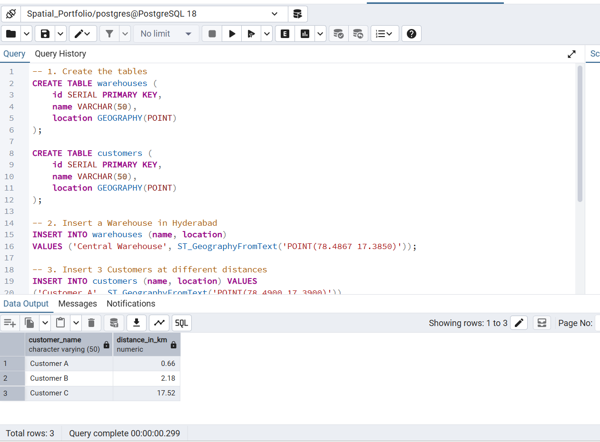

Project 1: Distance Calculator (Proximity Analysis)
Objective:
Calculate the exact geodesic distance (in kilometers) between a central warehouse and multiple customer locations using purely SQL, without the need for any desktop GIS software.

Tools Used:
PostgreSQL, PostGIS, pgAdmin 4

The Query:
The SQL script (01_distance_calculator.sql) creates two tables containing GEOGRAPHY(POINT) data types. It inserts one warehouse (Hyderabad) and three customers. The final SELECT query uses the PostGIS ST_Distance function to calculate the distance. It divides the result by 1000 to convert meters to kilometers, and casts the result to numeric to round to two decimal places.

The Result:

Result: Successfully calculated the distances (Customer A: 0.66km, Customer B: 2.18km, Customer C: 17.52km).